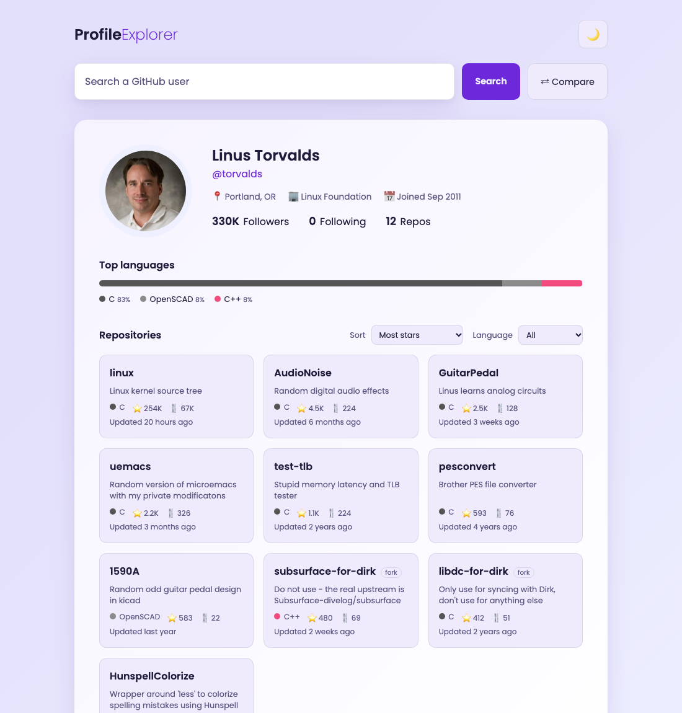

# Profile Explorer

Search any GitHub user to explore their profile, top repositories and languages, or compare two developers side by side. Built with plain HTML, CSS and JavaScript on the public [GitHub REST API](https://docs.github.com/en/rest), with no frameworks and no build step.

**Live demo:** https://khyalddinniazi.github.io/Github-Profiles/



## Features

- **Profile details**: avatar, bio, location, company, website, X/Twitter, join date, followers, following and repo counts
- **Repository cards**: description, language, stars, forks and last update
- **Sort and filter**: by stars, recently updated or name, and by language; "Show more" for paging
- **Top languages**: a breakdown bar of the languages the user's repos are written in
- **Compare mode**: put two users side by side, with the winner of each stat highlighted 🏆
- **Shareable links**: `?user=torvalds` or `?user=torvalds&vs=gaearon`, and back/forward navigation works
- **Recent searches**: your last 5 searches, saved in your browser
- **Dark and light theme**: follows your system setting by default and remembers your choice
- **Error handling**: clear messages for unknown users, API rate limits and network errors
- **Responsive and accessible**: works on mobile, supports the keyboard, and announces results to screen readers

## Run locally

```bash
git clone https://github.com/khyalddinniazi/Github-Profiles.git
cd Github-Profiles
python3 -m http.server 8000
# open http://localhost:8000
```

You can also open `index.html` directly in a browser.

> The GitHub API allows 60 unauthenticated requests per hour per IP. Each search uses 2 requests (4 in compare mode).

## Credits

Based on the GitHub Profiles project from [50 Projects in 50 Days](https://github.com/bradtraversy/50projects50days) by Brad Traversy and Florin Pop, then extended with the features above.
